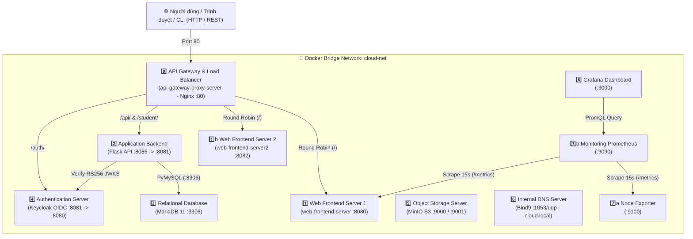

# ☁️ Đồ Án Cuối Kỳ: Xây Dựng Hệ Thống Mô Phỏng Đám Mây Thu Nhỏ (MyMiniCloud)

> **Học phần:** Điện Toán Đám Mây (Cloud Computing – Course ID: `504087` – TDTU)  
> **Mục tiêu hoàn thành:** **10.0 / 10.0 Điểm** *(5.0đ Phần Cơ Bản + 5.0đ Phần Mở Rộng 10/10 hạng mục)*

---

## 📌 1. Giới thiệu Dự án

**MyMiniCloud** là hệ thống mô phỏng hạ tầng của một nền tảng đám mây hoàn chỉnh (tương tự AWS, Azure, GCP) gồm **9 loại máy chủ dịch vụ bắt buộc + 1 Node Exporter + 1 Web Server Replica (Load Balancing)**. Toàn bộ các máy chủ chạy trong các **Docker Container** độc lập, kết nối chung qua mạng nội bộ ảo hóa **`cloud-net`** và được điều phối tự động bằng **Docker Compose**.

Hệ thống bao phủ đầy đủ các mô hình dịch vụ đám mây đã học:
- **IaaS (Infrastructure as a Service):** Mạng nội bộ `cloud-net`, lưu trữ đối tượng **MinIO S3**, phân giải tên miền nội bộ **Bind9 DNS**, triển khai trên **AWS EC2**.
- **PaaS (Platform as a Service):** Máy chủ ứng dụng **Flask REST API** (`application-backend-server`), cơ sở dữ liệu quan hệ **MariaDB 11** (`relational-database-server`).
- **SaaS (Software as a Service):** Cổng thông tin Web tĩnh & **Blog cá nhân 3 bài viết**, bảng điều khiển **Grafana Dashboard**, **MinIO Console**.
- **IDaaS (Identity as a Service):** Máy chủ xác thực tập trung **Keycloak OIDC / SSO** cấp phát và kiểm tra chữ ký số **RS256 JWT Access Token**.

---

## 🏗️ 2. Sơ đồ Kiến trúc Hệ thống (`cloud-net`)



---

## 📂 3. Cấu trúc Kho lưu trữ (Repository Structure)

```text
CLoud-tdtu/
├── 📄 README.md                                    # Tài liệu hướng dẫn tổng quan dự án (file này)
├── 📝 Bao_Cao_Cuoi_Ky_MyMiniCloud.docx             # BÁO CÁO WORD HOÀN CHỈNH (5 Chương + Phụ lục, để nộp)
├── 📘 CAM_NANG_HIEU_BAI_VA_KIEN_THUC_CUOI_KY.md    # Cẩm nang giải thích bản chất kiến thức & ôn vấn đáp
├── 📋 BAO_CAO_HOAN_THANH_CHO_BAN.md                # Bảng đối chiếu chi tiết từng yêu cầu đã hoàn thành
├── 🗜️ myminicloud_source_code.zip                  # Bản nén .zip của thư mục code myminicloud
└── 📁 myminicloud/                                 # THƯ MỤC MÃ NGUỒN DỰ ÁN CHÍNH (9 SERVER)
    ├── web-frontend-server/                        # [1] Nginx Web tĩnh + Blog 3 bài viết + /metrics
    ├── web-frontend-server2/                       # [1b] Nginx Web Server 2 (Replica cho Load Balancing)
    ├── application-backend-server/                 # [2] Flask API (/hello, /secure, /student, /students-db)
    ├── relational-database-server/                 # [3] MariaDB 11 (init SQL: minicloud.notes & studentdb.students)
    ├── authentication-identity-server/             # [4] Keycloak OIDC (tự động import realm_sv001.json)
    ├── object-storage-server/                      # [5] MinIO S3 (chứa sample-files: avatar.png, cloud_summary.pdf)
    ├── internal-dns-server/                        # [6] Bind9 DNS (zone cloud.local đầy đủ bản ghi A)
    ├── monitoring-prometheus-server/               # [7] Prometheus (scrape job 'node' và job 'web')
    ├── monitoring-grafana-dashboard-server/        # [8] Grafana (auto-provision Datasource & Dashboard 3 biểu đồ)
    ├── api-gateway-proxy-server/                   # [9] Nginx Reverse Proxy & Round Robin Load Balancer
    ├── docker-compose.yml                          # Điều phối toàn bộ 11 containers trên mạng cloud-net
    ├── test_all.ps1                                # Script tự động khởi chạy & kiểm thử 20 mục (Windows PowerShell)
    ├── test_all.sh                                 # Script tự động khởi chạy & kiểm thử 20 mục (Linux / Ubuntu)
    └── deploy_ec2.sh                               # Script tự động cài Docker & triển khai trên AWS EC2 Ubuntu
```

---

## 🌐 4. Bảng Cổng Dịch vụ (Ports) & Tài khoản Đăng nhập Mặc định

| STT | Dịch vụ / Server | Tên Container | Địa chỉ Truy cập (Local) | Tài khoản / Mật khẩu |
| :-: | :--- | :--- | :--- | :--- |
| **1** | **Web Frontend 1** | `web-frontend-server` | `http://localhost:8080/`<br>`http://localhost:8080/blog/` | *Public (Không cần đăng nhập)* |
| **1b** | **Web Frontend 2** *(Replica)* | `web-frontend-server2` | `http://localhost:8082/` | *Public (Không cần đăng nhập)* |
| **2** | **Application Backend** *(Flask)* | `application-backend-server` | `http://localhost:8085/hello`<br>`http://localhost:8085/student`<br>`http://localhost:8085/students-db` | `/secure` dùng Bearer Token của Keycloak |
| **3** | **Relational Database** *(MariaDB)* | `relational-database-server` | `localhost:3306` | User: `root`<br>Pass: `root` |
| **4** | **Authentication** *(Keycloak)* | `authentication-identity-server` | `http://localhost:8081/` | Admin: `admin` / `admin`<br>User test (`realm_sv001`): `sv01` / `123456` |
| **5** | **Object Storage** *(MinIO)* | `object-storage-server` | Console: `http://localhost:9001/`<br>S3 API: `http://localhost:9000/` | User: `minioadmin`<br>Pass: `minioadmin` |
| **6** | **Internal DNS** *(Bind9)* | `internal-dns-server` | `127.0.0.1:1053` (UDP/TCP) | Zone: `cloud.local` |
| **7** | **Monitoring Prometheus** | `monitoring-prometheus-server`<br>`monitoring-node-exporter-server` | `http://localhost:9090/targets`<br>`http://localhost:9100/metrics` | *Public* |
| **8** | **Monitoring Grafana** | `monitoring-grafana-dashboard-server` | `http://localhost:3000/` | User: `admin`<br>Pass: `admin` |
| **9** | **API Gateway & Load Balancer** | `api-gateway-proxy-server` | `http://localhost/`<br>`http://localhost/api/hello`<br>`http://localhost/student/`<br>`http://localhost/auth/` | *Điểm truy cập hợp nhất (Port 80)* |

---

## 🚀 5. Hướng dẫn Cài đặt, Khởi chạy & Kiểm thử Tự động

### Cách 1: Chạy trên Windows (PowerShell)
1. Cài đặt và bật **Docker Desktop** (đảm bảo trạng thái *Engine running*).
2. Mở **PowerShell**, di chuyển vào thư mục `myminicloud` và chạy kịch bản tự động:
   ```powershell
   git clone https://github.com/luan0217091310-gif/CLoud-tdtu.git
   cd CLoud-tdtu/myminicloud
   .\test_all.ps1
   ```
   *(Script `test_all.ps1` sẽ tự động build image, bật 11 containers, tạo bucket MinIO `demo` & `profile-pics`, nạp dữ liệu và chạy kiểm thử tự động toàn bộ 10 mục Cơ bản + 10 mục Mở rộng).*

### Cách 2: Chạy trên Linux / macOS / Ubuntu
```bash
git clone https://github.com/luan0217091310-gif/CLoud-tdtu.git
cd CLoud-tdtu/myminicloud
chmod +x test_all.sh
./test_all.sh
```

### Cách 3: Triển khai lên máy ảo đám mây AWS EC2 (Ubuntu Server)
```bash
git clone https://github.com/luan0217091310-gif/CLoud-tdtu.git
cd CLoud-tdtu/myminicloud
chmod +x deploy_ec2.sh test_all.sh
./deploy_ec2.sh
./test_all.sh
```

---

## ✅ 6. Danh mục Hoàn thành 20 Tiêu chí Chấm điểm (10/10 Điểm)

### Phần A: 10 Yêu cầu Cơ Bản (5.0 / 5.0 Điểm)
- [x] **1. Web Frontend Server:** Phục vụ trang chủ `/` và `/blog/` trả về `HTTP/1.1 200 OK`.
- [x] **2. Application Backend Server:** Route `/hello` trả về `{"message":"Hello from App Server!"}` trực tiếp và qua `/api/hello`.
- [x] **3. Relational Database Server:** Tự động khởi tạo CSDL `minicloud` và bảng `notes` có bản ghi `Hello from MariaDB!`.
- [x] **4. Authentication Identity Server:** Keycloak OIDC hoạt động ở cổng `8081`, đăng nhập quản trị `admin/admin`.
- [x] **5. Object Storage Server:** MinIO hoạt động ở cổng `9000/9001`, tạo bucket `demo` và lưu trữ `index.html`.
- [x] **6. Internal DNS Server:** Bind9 phân giải `web-frontend-server.cloud.local` trả về `10.10.10.10`.
- [x] **7. Monitoring Prometheus + Node Exporter:** Thu thập metric `node_cpu_seconds_total`, target `node` ở trạng thái `UP`.
- [x] **8. Monitoring Grafana Dashboard:** Kết nối nguồn dữ liệu Prometheus và hiển thị biểu đồ giám sát.
- [x] **9. API Gateway Proxy Server:** Định tuyến hợp nhất `/`, `/api/hello`, `/auth/` (redirect `302`) qua cổng `80`.
- [x] **10. Kiểm tra thông mạng (`ping`):** Toàn bộ các container trong mạng `cloud-net` ping thông suốt 100% (`0% packet loss`).

### Phần B: 10 Yêu cầu Mở Rộng – Cloud App Integration Practice (5.0 / 5.0 Điểm)
- [x] **Mở rộng 1 (`0.5đ` - Web Blog):** Xây dựng Blog cá nhân tại `/blog/` với 3 bài viết HTML (`blog1.html`, `blog2.html`, `blog3.html`) kèm ảnh minh họa SVG và liên kết tại `index.html`.
- [x] **Mở rộng 2 (`0.5đ` - Backend JSON API):** Tạo `students.json` (5 sinh viên) và route `GET /student` trả về JSON qua `http://localhost/api/student`.
- [x] **Mở rộng 3 (`0.5đ` - Database & CRUD API):** Tạo CSDL `studentdb`, bảng `students` (5 bản ghi, thực hành `SELECT, INSERT, UPDATE, DELETE`) và kết nối trực tiếp từ Flask qua API `http://localhost/api/students-db`.
- [x] **Mở rộng 4 (`0.5đ` - Keycloak OIDC):** Tự động khởi tạo Realm `realm_sv001`, Public Client `flask-app`, 2 user `sv01` & `sv02`, lấy RS256 Access Token và gọi thành công vào `/api/secure`.
- [x] **Mở rộng 5 (`0.5đ` - MinIO Object Storage):** Tạo bucket `profile-pics`, upload ảnh đại diện `avatar.png` và tài liệu `cloud_summary.pdf` với quyền truy cập Public Read URL.
- [x] **Mở rộng 6 (`0.5đ` - Bind9 Internal DNS):** Bổ sung các bản ghi `app-backend.cloud.local` (`10.10.10.20`), `minio.cloud.local` (`10.10.10.30`), `keycloak.cloud.local` (`10.10.10.40`) và xác minh bằng `dig`.
- [x] **Mở rộng 7 (`0.5đ` - Prometheus Target Web):** Bổ sung `job_name: 'web'` giám sát `web-frontend-server:80/metrics`, đảm bảo cả 2 target `node` và `web` đều `UP`.
- [x] **Mở rộng 8 (`0.5đ` - Grafana Custom Dashboard):** Thiết lập Dashboard `System Health of SV001` gồm 3 biểu đồ: *CPU Usage (%)*, *Memory Usage*, *Network Traffic*.
- [x] **Mở rộng 9 (`0.5đ` - API Gateway Routing):** Cấu hình route `location /student/` trên Nginx Proxy trỏ trực tiếp tới API `/student` của Backend.
- [x] **Mở rộng 10 (`0.5đ` - Load Balancing Round Robin):** Triển khai 2 máy chủ `web-frontend-server1` và `web-frontend-server2`, cấu hình cân bằng tải **Round Robin** trên Nginx Reverse Proxy.

---

## 👥 7. Hướng dẫn Dành cho Các Bạn Cùng Nhóm Chỉnh sửa & Nộp bài

1. **Chỉnh sửa Báo cáo Word:**
   - Mở file [`Bao_Cao_Cuoi_Ky_MyMiniCloud.docx`](./Bao_Cao_Cuoi_Ky_MyMiniCloud.docx).
   - Điền **Họ tên, MSSV, Lớp/Nhóm** vào Trang bìa.
2. **Đọc hiểu nhanh kiến thức để bảo vệ / vấn đáp:**
   - Xem file [`CAM_NANG_HIEU_BAI_VA_KIEN_THUC_CUOI_KY.md`](./CAM_NANG_HIEU_BAI_VA_KIEN_THUC_CUOI_KY.md).
3. **Kiểm tra chi tiết từng file đã làm:**
   - Xem file [`BAO_CAO_HOAN_THANH_CHO_BAN.md`](./BAO_CAO_HOAN_THANH_CHO_BAN.md).
